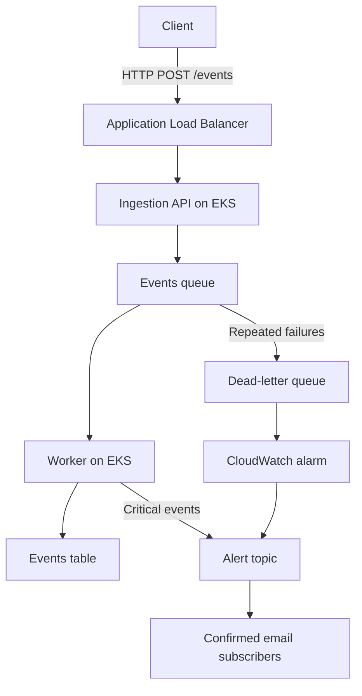

# AtlasOps — Cloud-Native Network Incident Platform

AtlasOps is an AWS and Kubernetes learning project for processing network events. A FastAPI ingestion service validates incoming events and puts them on Amazon SQS. Background workers store events in DynamoDB and publish critical-event notifications through SNS.



## What is included

- Terraform for a VPC, public/private subnets, NAT, EKS, ECR, SQS, DynamoDB, SNS, CloudWatch alarms, and IAM roles.
- Two replicas each of the ingestion API and worker, running as non-root containers.
- IAM Roles for Service Accounts (IRSA) for application access to AWS without static credentials in pods.
- GitHub Actions image builds and deployment pull requests, plus an Argo CD application for GitOps reconciliation.
- Argo CD Applications for AtlasOps, kube-prometheus-stack, and the AWS Load Balancer Controller.
- Prometheus/Grafana with gp3 EBS-backed persistent storage, provisioned through the EBS CSI driver.
- Python application metrics for ingestion, storage outcomes, processing failures, latency, and notification handling.
- An internet-facing ALB Ingress for ingestion, restricted to a configured client IPv4 CIDR. Dashboards remain internal.

## Implementation status

Validated in the lab: event ingestion → SQS → DynamoDB, critical-event SNS email, duplicate handling, failed-message retries and DLQ alarms, image builds/deployment PRs, Argo CD reconciliation, ALB provisioning, and persistent monitoring volumes.

Application metrics endpoints are implemented. The ServiceMonitor setup below completes collection; verify all four targets before claiming application dashboards are operational. A Kubernetes 1.36 → 1.37 upgrade has passed the reported EKS readiness checks but was not yet confirmed complete at this documentation update.

This is a development capstone, not a production SLA-backed service. S3 event archival, Route 53 DNS, and a separate notifier service are not part of the active event-processing path. Notifications run inside the worker.

## Repository layout

| Path | Purpose |
| --- | --- |
| `app/event_schema.py` | Shared validation schema for network events |
| `app/ingestion/` | HTTP API and its Dockerfile |
| `app/worker/` | Queue consumer and its Dockerfile |
| `infra/environments/dev/` | Development infrastructure, variables, outputs, and IAM policies |
| `kubernetes/base/` | Application manifests, internal Services, and application ServiceMonitors when added |
| `kubernetes/argocd/` | AtlasOps, monitoring, and load-balancer-controller Application manifests |
| `kubernetes/controllers/` | Load Balancer Controller Helm values |
| `kubernetes/monitoring/` | kube-prometheus-stack Helm values and gp3 StorageClass |
| `kubernetes/optional/` | Ingress manifest if not yet moved into the AtlasOps watched path |
| `.github/workflows/` | OIDC diagnostic and build/deployment workflows |

## Prerequisites

Use an AWS account with provisioning permissions, AWS CLI credentials, Terraform matching the repository’s `required_version` constraint, kubectl, Helm, and Docker. Python 3.12 is used by the container images. Argo CD must already be installed if you use the GitOps deployment option.

Terraform state is configured for the HCP Terraform organization and workspace in `infra/environments/dev/cloud.tf`. Authenticate with `terraform login` and ensure you have access, or configure your own state backend before initialization. Configure AWS credentials in the Terraform execution environment as well as locally where needed.

### Configure your environment

The checked-in configuration targets a specific development account and repository. Before using another environment, review:

- `providers.tf`: allowed AWS account ID and region.
- `variables.tf`: tags, subnet ranges, and `my_public_ipv4`, which restricts access to the EKS public API.
- `main.tf`: Kubernetes version, instance type, node counts, and add-ons; confirm the selected version is available in your AWS region.
- `github-oidc.tf` and `.github/workflows/`: account IDs, repository identity, role ARNs, and ECR names. The OIDC subject must match the claims GitHub issues for your repository.
- `sns.tf`: account and alarm ARN restrictions.
- `kubernetes/base/`: ECR image references, service-account role ARNs, and ConfigMap values.
- Controller values and optional Ingress: cluster name, VPC ID, role ARN, and allowed client CIDR.
- Argo CD application: repository URL and target branch.

Create an ignored `infra/environments/dev/local.auto.tfvars` file with your own values:

```hcl
my_public_ipv4 = "YOUR_PUBLIC_IPV4/32"
alert_emails = {
  operator = "you@example.com"
}
```

Terraform loads every `*.auto.tfvars` file. Avoid conflicting duplicate values. Keep credentials and real environment tfvars out of Git. For HCP Terraform runs, ensure required variables and AWS credentials are available in that workspace; local CLI authentication alone does not authenticate a remote run.

## Provision the infrastructure

From the repository root:

```bash
# Authenticate and confirm the target AWS account.
export AWS_PROFILE=Azadeh_neuFischer
export AWS_REGION=us-east-1
aws sts get-caller-identity
terraform login

# Download providers/modules, validate, and review changes before applying.
terraform -chdir=infra/environments/dev init
terraform -chdir=infra/environments/dev validate
terraform -chdir=infra/environments/dev plan
terraform -chdir=infra/environments/dev apply

# Inspect resource names, URLs, and role ARNs needed by Kubernetes.
terraform -chdir=infra/environments/dev output

# Connect kubectl to the new EKS cluster.
aws eks update-kubeconfig \
  --region "$(terraform -chdir=infra/environments/dev output -raw region)" \
  --name "$(terraform -chdir=infra/environments/dev output -raw cluster_name)"
kubectl get nodes
```

Update the Kubernetes ConfigMap, service-account annotations, and image references using the outputs before deploying. Confirm the SNS email subscriptions using the messages AWS sends to each recipient.

## Build and deploy

The image workflow runs manually or on application/build changes pushed to `main`. It authenticates to AWS with OIDC, builds Linux AMD64 images for both services, and pushes them to ECR with the commit SHA as the tag. Once both builds succeed, it proposes a pull request updating the Kubernetes image references. GitHub repository settings must allow Actions to create pull requests.

For local builds, run from the repository root so Docker can copy the shared application files:

```bash
docker build --platform linux/amd64 -f app/ingestion/Dockerfile -t atlasops-ingestion:local .
docker build --platform linux/amd64 -f app/worker/Dockerfile -t atlasops-worker:local .
```

These local tags are for local use. EKS deployment requires images published to the ECR repositories and matching image references in the manifests.

### Argo CD deployment and daily lab rebuild

1. Provision infrastructure and update kubeconfig as above. Confirm nodes are Ready and networking/EBS CSI add-ons are healthy.
2. Update environment-specific values, especially the controller's VPC ID after recreation and the Ingress client CIDR. Commit and merge changes into `main`.
3. If ECR images were deleted, trigger the build workflow and merge its deployment-image PR. Confirm every manifest tag exists in ECR.
4. Install a pinned Argo CD release into the `argocd` namespace using your installation manifest. Reconnect the private GitHub repository after a cluster rebuild. Keep its credentials outside Git.
5. Register the controller and monitoring Applications:

```bash
kubectl apply -f kubernetes/argocd/lb-controller-application.yaml
kubectl apply -f kubernetes/argocd/monitoring-application.yaml
kubectl get applications -n argocd
```

Wait for the controller and monitoring stack to become healthy. In particular, the monitoring stack must install the ServiceMonitor CRD before AtlasOps ServiceMonitor resources can be created.

```bash
kubectl get crd servicemonitors.monitoring.coreos.com
kubectl apply -f kubernetes/argocd/atlasops-application.yaml
kubectl get applications -n argocd
kubectl get pods -A
kubectl get pvc -n monitoring
kubectl get ingress -n atlasops
```

The AtlasOps Application watches `kubernetes/base` on `main`. Automatic sync and self-healing are enabled; automatic pruning is disabled. Argo does not automatically discover Application YAML files simply because the repository is connected: register each Application after a new cluster is created.

The controller and monitoring Applications render Helm charts with Git-hosted values. Argo manages the rendered resources; avoid parallel `helm upgrade`/`helm uninstall` operations on these same installations.

**Two PRs serve different purposes:** merging application code into `main` triggers image builds; merging the resulting deployment-image PR promotes those images to the cluster. A refresh in Argo cannot deploy an image tag that has not been merged into its watched branch. Manifest-only changes do not require an image build.

## Send a sample event

Expose the internal ingestion Service locally:

```bash
kubectl -n atlasops port-forward service/ingestion 8080:80
```

In another terminal:

```bash
curl http://localhost:8080/health

curl -i http://localhost:8080/events \
  -H 'Content-Type: application/json' \
  -d '{
    "event_id": "demo-001",
    "device_id": "router-01",
    "event_type": "link_down",
    "severity": "warning",
    "timestamp": "2026-10-26T12:00:00Z",
    "message": "Uplink interface is down"
  }'
```

Successful submission returns HTTP `202` with the event ID and SQS message ID. It confirms queuing; processing happens asynchronously. Severity must be `info`, `warning`, or `critical`, the timestamp must include a timezone, and extra fields are rejected. Replace the example timestamp with the current UTC time and use a new event ID for each new event. Reusing `demo-001` intentionally tests duplicate handling. A `critical` event also triggers an SNS notification after storage.

Inspect the pods and processing logs:

```bash
kubectl -n atlasops get pods,services
kubectl -n atlasops logs -l app=ingestion --tail=50
kubectl -n atlasops logs -l app=worker --tail=50
```

## Monitoring and application metrics

Monitoring is deployed by the `monitoring` Argo CD Application, using kube-prometheus-stack and the values in `kubernetes/monitoring/values.yaml`. Use the chart version pinned in the Application manifest; the previously validated chart version was `92.11.0`.

Grafana has a 5 GiB gp3 PVC and Prometheus has a 10 GiB gp3 PVC. Both were verified Bound. Retention is configured in the Helm values. The EBS CSI driver provisions these encrypted volumes through the gp3 StorageClass.

Pod replacement does not inherently delete a PVC. However, the current StorageClass/PVs use `reclaimPolicy: Delete`: deleting a PVC can delete its EBS volume. Nightly lab cleanup may also remove storage. Persistence is not a backup or high availability; Grafana and Prometheus each have one replica.

Use separate terminals for dashboard access:

```bash
kubectl -n monitoring port-forward service/monitoring-grafana 3000:80
kubectl -n monitoring port-forward service/monitoring-kube-prometheus-prometheus 9090:9090
kubectl -n argocd port-forward service/argocd-server 8081:443
```

Open Grafana at `http://localhost:3000`, Prometheus at `http://localhost:9090`, and Argo CD at `https://localhost:8081`. These Services have no dashboard Ingress configured.

Retrieve Grafana credentials locally; do not share or commit them:

```bash
kubectl -n monitoring get secret monitoring-grafana \
  -o jsonpath='{.data.admin-user}' | base64 --decode
echo
kubectl -n monitoring get secret monitoring-grafana \
  -o jsonpath='{.data.admin-password}' | base64 --decode
echo
```

If credentials fail after a Secret change, the persistent Grafana database may retain a different password. Changing the Kubernetes Secret alone is not proof that the database password changed; use Grafana's admin password recovery procedure without deleting its PVC.

### Application scraping

| Component | Endpoint | Metrics Service |
| --- | --- | --- |
| Ingestion | Pod port `8080`, path `/metrics/` | `ingestion-metrics` |
| Worker | Pod port `8000`, path `/metrics` | `worker-metrics` |

`prometheus-client` counters and histograms are updated by the application code. The worker starts its own background HTTP metrics server. Each pod exposes its own measurements; Prometheus discovers and scrapes each replica separately.

The intended resources are `kubernetes/base/metric-services.yaml` and `kubernetes/base/servicemonitors.yaml`. Ensure both are committed and merged into `main`. Each ServiceMonitor needs `release: monitoring` to match the observed Prometheus selector. Its selector matches Service metadata labels (`app` and `purpose: metrics`); the Service selector matches pod labels. Endpoint `port: metrics` refers to the Service's named port.

```bash
kubectl get servicemonitor -n atlasops
kubectl get svc ingestion-metrics worker-metrics -n atlasops
```

In Prometheus, verify:

```promql
up{namespace="atlasops"}
```

Expected: four application targets with value `1`, for two ingestion and two worker pods. A `0` means a discovered target failed its scrape; no results means discovery needs checking. Scraping does not depend on local port-forwarding.

Useful queries for Grafana panels:

```promql
# Estimated queued submissions in the last 15 minutes, across both replicas
sum(increase(atlasops_ingestion_events_queued_total{namespace="atlasops"}[15m]))

# Processing attempt rate by outcome
sum by (outcome) (rate(atlasops_worker_processing_attempts_total{namespace="atlasops"}[5m]))

# Failed processing attempts by stage
sum by (stage) (increase(atlasops_worker_processing_failures_total{namespace="atlasops"}[15m]))

# Estimated p95 processing duration in seconds
histogram_quantile(0.95,
  sum by (le) (rate(atlasops_worker_processing_duration_seconds_bucket{namespace="atlasops"}[5m]))
)
```

Counters reset on process restart; use `rate`/`increase` for time-window activity. These queries need sufficient scrape samples. `increase` is an estimate, not an exact event audit count. Queue submissions include repeat submissions, and worker attempts include retries. The `published` notification outcome means SNS publishing and the status update completed, not that an email was delivered. Avoid event IDs or free-text messages as metric labels.

CloudWatch/SNS DLQ alerting remains independent. Alertmanager is disabled in the monitoring values; Prometheus-driven notifications and a validated application dashboard are separate follow-up work.

## Ingestion ALB

The AWS Load Balancer Controller is managed by its Argo CD Application. Terraform manages its IAM role and permissions. Update `kubernetes/controllers/aws-load-balancer-controller-values.yaml` with the current cluster name, region, VPC ID and service-account role ARN before syncing.

An ingestion Ingress has been provisioned in the lab. To reproduce it through AtlasOps auto-sync, its manifest must be under `kubernetes/base`. If it remains in `kubernetes/optional/ingestion-ingress.yaml`, it is outside that Application's watched path and needs explicit deployment or migration into that path. Do not keep competing copies of the same resource.

```bash
kubectl -n atlasops get ingress ingestion
ALB_DNS=$(kubectl -n atlasops get ingress ingestion \
  -o jsonpath='{.status.loadBalancer.ingress[0].hostname}')
curl -i --max-time 30 "http://${ALB_DNS}/health"
```

With `target-type: ip`, the ALB routes to pod IPs; the controller configures AWS resources and is not in the request data path. The listener uses port 80, the Ingress references Service port 80, and the ingestion Service maps to pod port 8080.

The ALB uses HTTP and a restricted source CIDR. No application authentication or TLS is configured. A `/` prefix route also exposes the ingestion metrics endpoint under that same restriction. Dashboard Services remain private.

## Processing behavior and development limits

- SQS is a standard queue, so delivery can repeat. Conditional DynamoDB writes deduplicate stored events by `event_id`.
- The worker deletes a message after storage and any required notification work succeeds. Failures leave the message for retry; the redrive policy uses `maxReceiveCount: 5`, after which repeated failure leads to DLQ redrive. This is not a guaranteed five-minute timer.
- Notification publishing and its DynamoDB status update are separate operations. Retries or concurrent processing can produce duplicate notifications.
- `/health` checks the API process only; it does not test AWS connectivity. The worker has no Kubernetes health probes configured.
- Infrastructure includes billable EKS, EC2, NAT, and potentially ALB resources. This is a development configuration; repository deletion is configured to remove stored ECR images.

## Upgrade practice

The last verified baseline is EKS 1.36 with two Ready AL2023 nodes. EKS reported 1.37 available and all reported 1.37 upgrade insights passing. An upgrade completion has not been recorded here.

Before upgrading, check workload health, add-on and controller compatibility, disruption budgets, backups and the Terraform plan. Pin managed nodes to the existing version for a staged control-plane upgrade, then update nodes separately. Preserve the monitoring PVCs and validate event processing, email delivery, ALB health and metric targets afterward. AWS manages control-plane etcd; application data still needs its own backup/recovery process.

## Cleanup

Before teardown, back up data you want to retain and export UI-created Grafana dashboards. Pause automatic sync on the relevant Argo Applications (and any parent that manages them) before deleting Git-managed resources, otherwise self-healing may recreate them.

Delete the ingestion Ingress while the load-balancer controller is still running. Verify the ALB, target groups and associated controller-managed resources have been removed before destroying the cluster/VPC. If intentionally removing monitoring data, delete its PVCs while EBS CSI is still available and verify volume cleanup. Do not delete PVCs merely to restart pods.

For Argo-managed components, use deliberate Argo/Kubernetes cleanup rather than assuming `helm uninstall` will manage their lifecycle. Remove controller components only after their AWS resources are cleaned up. Check for retained volumes and snapshots after teardown; Terraform does not necessarily own resources created by Kubernetes controllers.

Review the destruction plan and destroy only when you intend to remove the environment and its stored data:

```bash
terraform -chdir=infra/environments/dev plan -destroy
terraform -chdir=infra/environments/dev destroy
```
