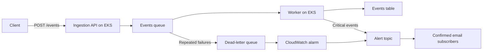

# AtlasOps

AtlasOps is an AWS and Kubernetes learning project for processing network events. A FastAPI ingestion service validates incoming events and puts them on Amazon SQS. Background workers store events in DynamoDB and publish critical-event notifications through SNS.



## What is included

- Terraform for a VPC, public/private subnets, NAT, EKS, ECR, SQS, DynamoDB, SNS, CloudWatch alarms, and IAM roles.
- Two replicas each of the ingestion API and worker, running as non-root containers.
- IAM Roles for Service Accounts (IRSA) for application access to AWS without static credentials in pods.
- GitHub Actions image builds and deployment pull requests, plus an Argo CD application for GitOps reconciliation.
- Helm values for Prometheus/Grafana and the AWS Load Balancer Controller, with an optional ALB Ingress.

## Repository layout

| Path | Purpose |
| --- | --- |
| `app/event_schema.py` | Shared validation schema for network events |
| `app/ingestion/` | HTTP API and its Dockerfile |
| `app/worker/` | Queue consumer and its Dockerfile |
| `infra/environments/dev/` | Development infrastructure, variables, outputs, and IAM policies |
| `kubernetes/base/` | Namespace, configuration, service accounts, deployments, and internal Service |
| `kubernetes/argocd/` | Argo CD application tracking `main` |
| `kubernetes/controllers/` | Load Balancer Controller Helm values |
| `kubernetes/monitoring/` | kube-prometheus-stack Helm values |
| `kubernetes/optional/` | Opt-in public HTTP Ingress |
| `.github/workflows/` | OIDC diagnostic and build/deployment workflows |

## Prerequisites

Use an AWS account with provisioning permissions, AWS CLI credentials, Terraform `>= 1.16.0, < 2.0.0`, kubectl, Helm, and Docker. Python 3.12 is used by the container images. Argo CD must already be installed if you use the GitOps deployment option.

Terraform state is configured for the HCP Terraform organization and workspace in `infra/environments/dev/cloud.tf`. Authenticate with `terraform login` and ensure you have access, or configure your own state backend before initialization. Configure AWS credentials in the Terraform execution environment as well as locally where needed.

### Configure your environment

The checked-in configuration targets a specific development account and repository. Before using another environment, review:

- `providers.tf`: allowed AWS account ID and region.
- `variables.tf`: tags, subnet ranges, and `my_public_ipv4`, which restricts access to the EKS public API.
- `main.tf`: Kubernetes version, instance type, node counts, and add-ons; confirm the selected version is available in your AWS region.
- `github-oidc.tf` and `.github/workflows/`: account IDs, repository identity, role ARNs, and ECR names. The OIDC subject must match the claims GitHub issues for your repository.
- `sns.tf`: account and alarm ARN restrictions.
- `kubernetes/base/`: ECR image references, service-account role ARNs, and ConfigMap values.
- Controller values and optional Ingress: cluster name, VPC ID, role ARN, and allowed client CIDR.
- Argo CD application: repository URL and target branch.

Create an ignored `infra/environments/dev/local.auto.tfvars` file with your own values:

```hcl
my_public_ipv4 = "YOUR_PUBLIC_IPV4/32"
alert_emails = {
  operator = "you@example.com"
}
```

If a local `terrafrm.auto.tfvars` already exists, review or consolidate it: Terraform loads every `*.auto.tfvars` file, including that spelling. Local tfvars files are ignored by Git.

## Provision the infrastructure

From the repository root:

```bash
# Authenticate and confirm the target AWS account.
aws sts get-caller-identity
terraform login

# Download providers/modules, validate, and review changes before applying.
terraform -chdir=infra/environments/dev init
terraform -chdir=infra/environments/dev validate
terraform -chdir=infra/environments/dev plan
terraform -chdir=infra/environments/dev apply

# Inspect resource names, URLs, and role ARNs needed by Kubernetes.
terraform -chdir=infra/environments/dev output

# Connect kubectl to the new EKS cluster.
aws eks update-kubeconfig \
  --region "$(terraform -chdir=infra/environments/dev output -raw region)" \
  --name "$(terraform -chdir=infra/environments/dev output -raw cluster_name)"
kubectl get nodes
```

Update the Kubernetes ConfigMap, service-account annotations, and image references using the outputs before deploying. Confirm the SNS email subscriptions using the messages AWS sends to each recipient.

## Build and deploy

The image workflow runs manually or on application/build changes pushed to `main`. It authenticates to AWS with OIDC, builds Linux AMD64 images for both services, and pushes them to ECR with the commit SHA as the tag. Once both builds succeed, it proposes a pull request updating the Kubernetes image references. GitHub repository settings must allow Actions to create pull requests.

For local builds, run from the repository root so Docker can copy the shared application files:

```bash
docker build --platform linux/amd64 -f app/ingestion/Dockerfile -t atlasops-ingestion:local .
docker build --platform linux/amd64 -f app/worker/Dockerfile -t atlasops-worker:local .
```

These local tags are for local use. EKS deployment requires images published to the ECR repositories and matching image references in the manifests.

Choose one deployment workflow:

### Direct deployment

```bash
# Create the namespace first, then deploy the remaining application resources.
kubectl apply -f kubernetes/base/namespace.yaml
kubectl apply -f kubernetes/base/
kubectl -n atlasops rollout status deployment/ingestion
kubectl -n atlasops rollout status deployment/worker
```

### Argo CD

With Argo CD installed in the `argocd` namespace:

```bash
kubectl apply -f kubernetes/argocd/atlasops-application.yaml
```

The Application tracks `kubernetes/base` on `main`, automatically syncs changes, and repairs drift. Automatic pruning is disabled. Merge a deployment pull request to promote the new image tags. Controller, monitoring, and optional Ingress files are outside the watched directory and require separate installation.

## Send a sample event

Expose the internal ingestion Service locally:

```bash
kubectl -n atlasops port-forward service/ingestion 8080:80
```

In another terminal:

```bash
curl http://localhost:8080/health

curl -i http://localhost:8080/events \
  -H 'Content-Type: application/json' \
  -d '{
    "event_id": "demo-001",
    "device_id": "router-01",
    "event_type": "link_down",
    "severity": "warning",
    "timestamp": "2026-10-26T12:00:00Z",
    "message": "Uplink interface is down"
  }'
```

Successful submission returns HTTP `202` with the event ID and SQS message ID. It confirms queuing; processing happens asynchronously. Severity must be `info`, `warning`, or `critical`, the timestamp must include a timezone, and extra fields are rejected. Use a new event ID for a new event. A `critical` event also triggers an SNS notification after storage.

Inspect the pods and processing logs:

```bash
kubectl -n atlasops get pods,services
kubectl -n atlasops logs -l app=ingestion --tail=50
kubectl -n atlasops logs -l app=worker --tail=50
```

## Monitoring

Install the metrics stack separately:

```bash
helm repo add prometheus-community https://prometheus-community.github.io/helm-charts
helm repo update
helm upgrade --install monitoring prometheus-community/kube-prometheus-stack \
  --namespace monitoring --create-namespace \
  --version 92.11.0 \
  --values kubernetes/monitoring/values.yaml \
  --wait --timeout 10m

# Open Grafana at http://localhost:3000 while this command runs.
kubectl -n monitoring port-forward service/monitoring-grafana 3000:80
```

Retrieve the chart-generated Grafana admin password locally:

```bash
kubectl -n monitoring get secret monitoring-grafana \
  -o jsonpath='{.data.admin-password}' | base64 --decode
```

Use the `admin` username. Grafana persistence is disabled; Prometheus uses `emptyDir` with six-hour/1 GB retention settings. Pod replacement loses this data. CloudWatch and SNS handle the configured DLQ alarm independently of this stack.

## Optional public Ingress

First update `kubernetes/controllers/aws-load-balancer-controller-values.yaml` with the Terraform cluster, VPC, and IAM role outputs. Install the controller into `kube-system` using a chart version compatible with the checked-in IAM policy:

```bash
helm repo add eks https://aws.github.io/eks-charts
helm repo update
helm upgrade --install aws-load-balancer-controller eks/aws-load-balancer-controller \
  --namespace kube-system \
  --values kubernetes/controllers/aws-load-balancer-controller-values.yaml \
  --wait --timeout 10m

# Review the permitted client CIDR before creating the ALB.
kubectl apply -f kubernetes/optional/ingestion-ingress.yaml
kubectl -n atlasops get ingress ingestion
```

This creates an internet-facing HTTP load balancer restricted to the configured source CIDR. The API currently has no application authentication or TLS configuration; configure those before broader exposure.

## Processing behavior and development limits

- SQS is a standard queue, so delivery can repeat. Conditional DynamoDB writes deduplicate stored events by `event_id`.
- The worker deletes a message after storage and any required notification work succeeds. Failures leave the message for retry; after five receives it moves to the DLQ.
- Notification publishing and its DynamoDB status update are separate operations. Retries or concurrent processing can produce duplicate notifications.
- `/health` checks the API process only; it does not test AWS connectivity. The worker has no Kubernetes health probes configured.
- Infrastructure includes billable EKS, EC2, NAT, and potentially ALB resources. This is a development configuration; repository deletion is configured to remove stored ECR images.

## Cleanup

Delete the optional Ingress while the load-balancer controller is still running, and verify its AWS load balancer has been removed before destroying the cluster. Remove the Argo CD Application or disable its automatic synchronization before manually deleting app resources. Uninstall separately installed Helm releases before infrastructure teardown.

Review the destruction plan and destroy only when you intend to remove the environment and its stored data:

```bash
terraform -chdir=infra/environments/dev plan -destroy
terraform -chdir=infra/environments/dev destroy
```
